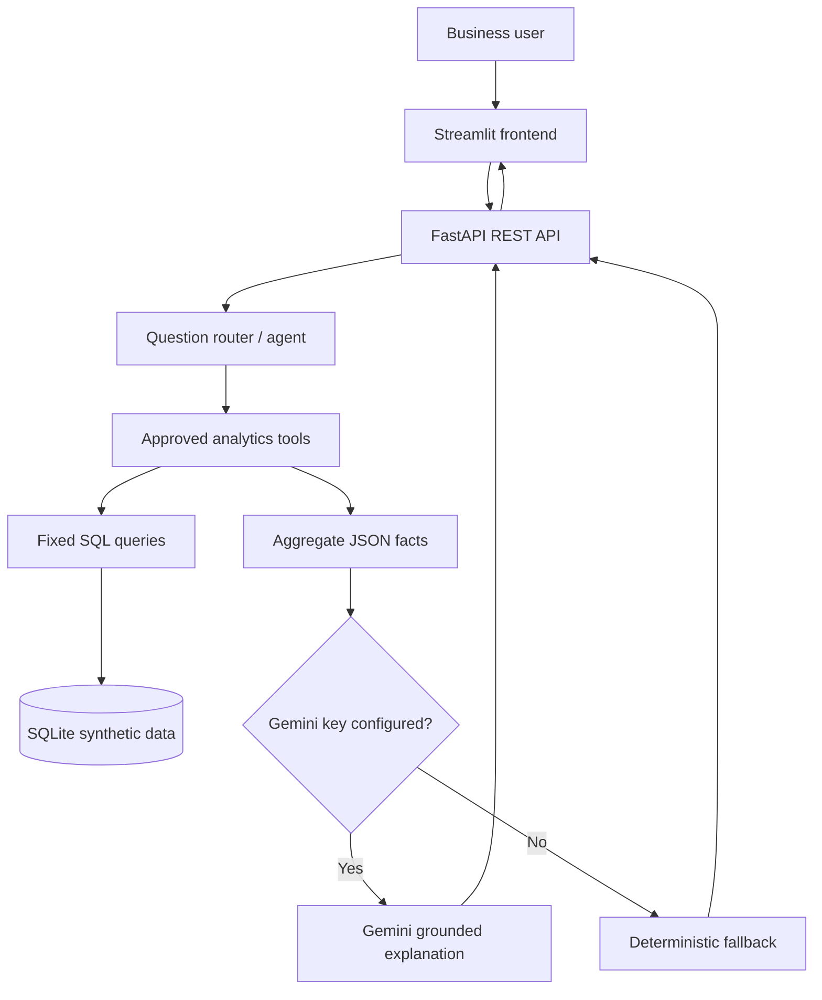

# PHS Investments | Business Intelligence & AI Analytics Copilot


> **Portfolio project using synthetic data only.** This is an educational business analytics demo, not an actual investment system, financial report, or investment recommendation.

## Overview

An end-to-end business intelligence application that combines structured analytics with a Gemini-powered assistant. It simulates the questions a mutual-fund distribution business might ask about transaction flows, SIP registrations, client segments, scheme categories and geographic trends.

The project is designed to demonstrate a complete workflow:
1. Store relational business data.
2. Calculate KPIs with explicit SQL definitions.
3. Expose analytics through a Python API.
4. Display charts and KPIs in a web dashboard.
5. Let users ask natural-language questions through a controlled AI tool layer.
6. Test outputs, document assumptions and communicate business limitations.

## Features in the current MVP

- Reproducible synthetic data seeded into SQLite on first API startup.
- Relational tables for clients, schemes, SIP registrations and transactions.
- Fixed, read-only SQL analytics functions for flows, monthly trends, cities, schemes and SIP status.
- FastAPI endpoints with request validation and interactive API docs.
- Streamlit frontend with KPI cards, monthly trends and ranking charts.
- Optional Gemini-generated explanations grounded in aggregate facts.
- Deterministic fallback responses when no Gemini API key is configured or the API is unavailable.
- A small automated test suite and SQL examples.
- Architecture and learning guides to support interview preparation.

## Architecture



## Tech stack

- **Data / analytics:** SQL, SQLite, Python, Pandas
- **API:** FastAPI, Pydantic, Uvicorn
- **UI / visualization:** Streamlit, Plotly
- **AI:** Gemini API via Google Gen AI SDK; approved tool routing and grounding
- **Testing:** pytest, FastAPI-compatible test dependencies
- **Next extension:** Power BI report and optional BigQuery-backed data layer

## Run locally

Python 3.11 or 3.12 is recommended.

### 1. Clone and install

```bash
git clone https://github.com/HARSHDEEP-SINHA/phs-investments-business-analytics.git
cd phs-investments-business-analytics
python -m venv .venv
```

Activate the environment:

```bash
# Windows PowerShell
.venv\\Scripts\\Activate.ps1

# macOS / Linux
source .venv/bin/activate
```

Install dependencies and create local configuration:

```bash
pip install -r requirements.txt
```

Copy `.env.example` to `.env` (on Windows, copy the file using File Explorer or PowerShell). Gemini is optional for the first run.

### 2. Start the API

From the repository root:

```bash
uvicorn backend.main:app --reload
```

The API creates the SQLite database and deterministic synthetic records on first startup.

- Health check: http://127.0.0.1:8000/health
- Interactive API documentation: http://127.0.0.1:8000/docs

### 3. Start the dashboard

Open a second terminal, activate the same virtual environment and run:

```bash
streamlit run frontend/streamlit_app.py
```

Open the local URL Streamlit prints (usually http://localhost:8501).

### 4. Enable Gemini (optional)

Add a Gemini API key you are authorized to use to your local `.env`:

```dotenv
GEMINI_API_KEY=your_key_here
GEMINI_MODEL=gemini-2.5-flash
```

Restart the API after changing environment variables. Model availability, quotas and billing depend on the Google account and service configuration. Without a key, the application still works with deterministic answers.

**Never commit `.env`, API keys, service-account keys or real client data.**

## API endpoints

| Method | Endpoint | Purpose |
|---|---|---|
| GET | `/health` | Health check |
| GET | `/api/overview` | Top-level KPI aggregates |
| GET | `/api/monthly` | Monthly inflows, outflows and net flows |
| GET | `/api/cities` | City-level synthetic performance |
| GET | `/api/schemes` | Scheme-level synthetic performance |
| GET | `/api/sips` | SIP registration status summary |
| POST | `/api/chat` | Route a natural-language question to an approved analytics tool |

Example request:

```bash
curl -X POST http://127.0.0.1:8000/api/chat \
  -H "Content-Type: application/json" \
  -d '{"question":"Which cities have the highest inflows?"}'
```

## Business metric definitions

- **Inflows:** successful PURCHASE, SIP_INSTALLMENT and SWITCH_IN transaction sums.
- **Outflows:** successful REDEMPTION and SWITCH_OUT transaction sums.
- **Net flows:** inflows minus outflows.
- **Active clients:** client records marked Active.
- **Transacting clients:** distinct clients with successful transactions.
- **Active SIP monthly value:** sum of registered monthly amounts for active SIP records; it is not actual monthly collections.
- **Illustrative commission rate:** synthetic scheme attribute, not actual accounting revenue. The MVP does not claim to calculate realized revenue.
- **AUM:** not calculated. Transaction flows cannot be presented as assets under management without holdings and valuation data.

These definitions are intentionally explicit. In interviews, explain the difference between transaction volume, net flows, AUM, returns and recognized revenue.

## AI design and guardrails

The AI layer is intentionally small enough to understand and defend:
1. A simple router selects an approved tool based on the question.
2. The selected tool executes a fixed read-only SQL query.
3. Only aggregate facts are passed to Gemini for a natural-language explanation.
4. Without Gemini, a deterministic response is returned.
5. The UI exposes the selected tool and underlying facts for inspection.

The model does not generate arbitrary SQL or write to the database. This is a prototype, not a production security architecture. Before any public deployment, add authentication, authorization, rate limiting, monitoring, secret management, audit logging and security review.

## Tests

```bash
pytest -q
```

Tests cover key KPI invariants, output structure, routing and the analytics tool allow-list.

## Repository structure

```text
backend/
  database.py          # SQLite schema and reproducible synthetic data
  analytics.py         # Fixed read-only SQL analytics
  agent.py             # Question routing and optional Gemini explanations
  main.py              # FastAPI endpoints
frontend/
  streamlit_app.py     # Dashboard and AI chat UI
sql/
  portfolio_queries.sql
tests/
  test_analytics.py
docs/
  ARCHITECTURE.md
  LEARNING_GUIDE.md
  PROJECT_PLAN.md
requirements.txt
.env.example
```

## Power BI / BI export

Generate local synthetic CSV tables and a basic data-quality report:

```bash
python -m scripts.export_powerbi_data
```

The generated `exports/` files are local-only and ignored by Git. Follow [docs/POWER_BI_GUIDE.md](docs/POWER_BI_GUIDE.md) for the suggested data model, report layout, DAX measures, Mac options and metric limitations. Power BI Desktop requires Windows; on macOS, use a Windows machine/VM or a browser-based BI alternative if Power BI Service authoring is unavailable.

## Roadmap

- [x] Relational schema and synthetic data generation
- [x] SQL-based business metrics
- [x] REST API
- [x] Interactive dashboard
- [x] Optional Gemini-powered explanations
- [x] Basic tests and learning documentation
- [ ] Power BI dashboard using the same dataset
- [ ] Date-range filters and additional data-quality checks
- [ ] At least 20 evaluated question/expected-facts pairs
- [ ] Optional BigQuery integration and Google Cloud deployment
- [ ] Authentication and production hardening before any public release

## Learning objectives

This project applies the Google Data Analytics workflow—ask, prepare, process, analyze, share and act—and extends it with a grounded AI assistant. See [docs/LEARNING_GUIDE.md](docs/LEARNING_GUIDE.md) for the runbook, data caveats, request flow and interview exercises.

## Disclaimer

All business records are synthetic and generated for learning. Names are fictional. The figures must not be represented as actual PHS Investments performance, customer data, investment advice or financial results.
