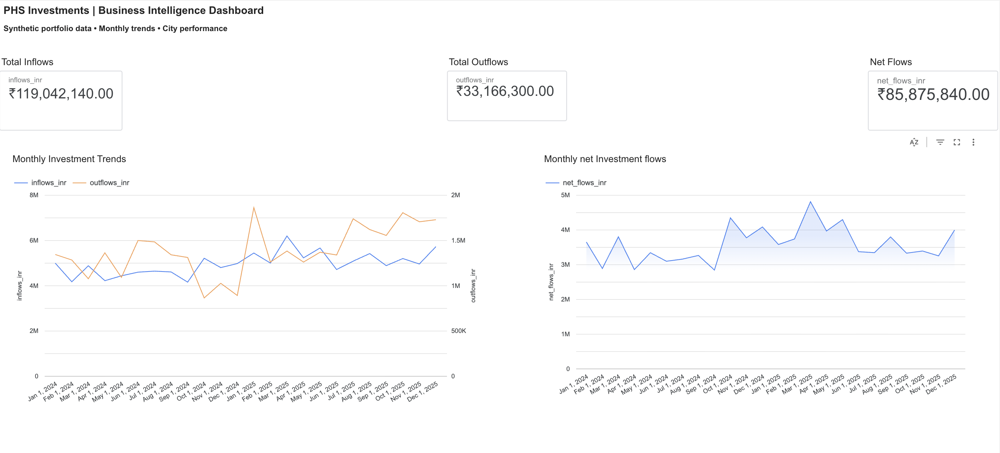
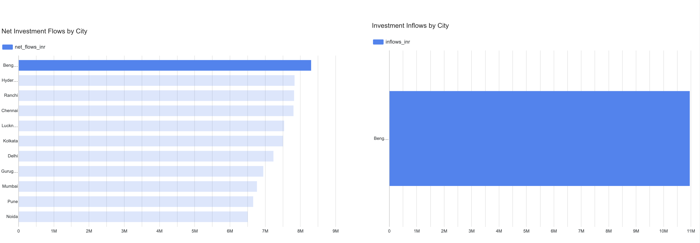
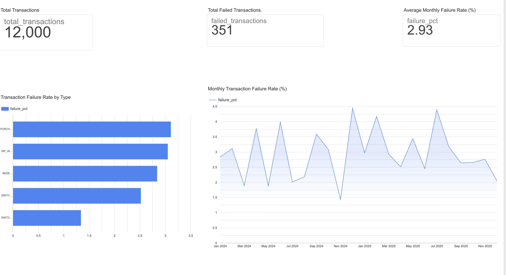
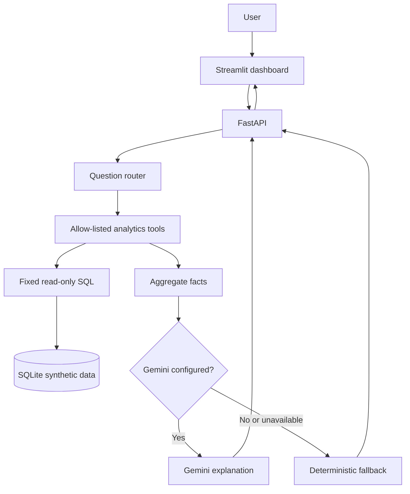

# PHS Investments — Business Intelligence & AI Analytics Copilot


> **Portfolio project using synthetic data only.** This is an educational business-intelligence demo. It is not an actual PHS Investments reporting system, financial report, investment recommendation, or source of real client results.

## What this project does

This project models a small mutual-fund distribution analytics workflow: relational data is stored in SQLite, metrics are calculated with fixed SQL queries, FastAPI exposes the results, and a Streamlit dashboard presents the KPIs. A natural-language assistant routes questions to a controlled set of read-only analytics tools and can use Gemini to phrase evidence-based explanations.

The aim is to demonstrate practical skills in **SQL, Python, data validation, KPI design, API development, dashboarding, and guarded AI-assisted analytics**—not to imply that the demo is a production financial platform.

### Dashboard preview

The repository includes screenshots and a build guide for a Looker Studio report connected to exports generated from the synthetic SQLite dataset.

| Overview | City performance | Transaction quality |
|---|---|---|
|  |  |  |

See [Business Insights & Recommendations](docs/BUSINESS_INSIGHTS.md) and the [Looker Studio dashboard guide](docs/LOOKER_STUDIO_DASHBOARD_BUILD.md) for metric definitions and report setup.

## Current capabilities

- Reproducible synthetic data generation for clients, schemes, SIP registrations, and transactions.
- Fixed, parameterized, read-only SQL analytics for overview KPIs, monthly flows, city and scheme performance, SIP registrations, and transaction failures.
- FastAPI endpoints with request validation and interactive API documentation.
- Streamlit dashboard with KPI cards, trend charts, ranking charts, and an analytics chat interface.
- Natural-language routing to an explicit tool allow-list; the model does not generate or execute arbitrary SQL.
- Deterministic responses when Gemini is not configured or is unavailable.
- Guardrails for personal client details, database-write requests, AUM, commission revenue, and ambiguous “last month” questions.
- Aggregate failure rates by transaction type and month, with caveats that descriptive patterns do not establish root causes.
- Automated tests for core KPI invariants, routing, comparison direction, failure analysis, and key safety cases.
- SQL examples, architecture notes, evaluation plan, and BI export guides.

## Architecture



**Trust boundaries:** SQL calculations remain in Python/SQLite; the question text is not interpolated into SQL. The AI path receives aggregate facts rather than individual client records. This is still a local portfolio prototype: it does not include authentication or production-grade authorization, monitoring, or operational controls.

## Technology

| Area | Tools |
|---|---|
| Data and metrics | Python, SQL, SQLite |
| API | FastAPI, Pydantic, Uvicorn |
| Dashboard | Streamlit, Pandas, Plotly |
| Optional AI | Google Gen AI SDK / Gemini |
| Tests | pytest |
| BI reporting | Looker Studio; CSV exports suitable for further BI work |

## Run locally

Python 3.11 or 3.12 is recommended.

### 1. Clone and install

```bash
git clone https://github.com/HARSHDEEP-SINHA/phs-investments-business-analytics.git
cd phs-investments-business-analytics
python -m venv .venv
source .venv/bin/activate
python -m pip install --upgrade pip
pip install -r requirements.txt
```

On Windows PowerShell, activate the environment with `.venv\\Scripts\\Activate.ps1`.

The application reads optional configuration from `.env`. Start without a Gemini key first; the deterministic path does not require one. If `.env.example` is present, copy it to `.env` and keep the key blank for the first run.

### 2. Start the API

From the repository root:

```bash
uvicorn backend.main:app --reload
```

On first startup, the API initializes the local SQLite schema and seeds deterministic synthetic data.

- Health check: http://127.0.0.1:8000/health
- API docs: http://127.0.0.1:8000/docs

### 3. Start the dashboard

Open a second terminal, activate the same virtual environment, and run:

```bash
streamlit run frontend/streamlit_app.py
```

Open the local URL printed by Streamlit, usually http://localhost:8501.

### 4. Run tests

From the project root with the virtual environment active:

```bash
python -m pytest -q
```

The test suite checks analytics invariants, routing, ranking direction, aggregate failure metrics, and safety responses. A test plan is not itself evidence of a pass: record the actual command output for the version you tested.

### 5. Enable Gemini (optional)

Add a Gemini API key you are authorized to use to your local `.env`:

```dotenv
GEMINI_API_KEY=your_key_here
GEMINI_MODEL=gemini-2.5-flash
```

Restart FastAPI after changing environment variables. Availability, quotas, and billing depend on the account and service configuration. If Gemini is not configured or a request fails, the app returns a deterministic answer.

**Never commit `.env`, API keys, service-account credentials, or real client data.**

## API endpoints

| Method | Endpoint | Purpose |
|---|---|---|
| `GET` | `/health` | Health check and synthetic-data marker |
| `GET` | `/api/overview` | Aggregate KPI totals |
| `GET` | `/api/monthly` | Monthly inflows, outflows, and net flows |
| `GET` | `/api/cities` | City-level synthetic performance |
| `GET` | `/api/schemes` | Scheme-level synthetic performance |
| `GET` | `/api/sips` | SIP status and registered monthly values |
| `GET` | `/api/failures` | Aggregate transaction failure counts and rates |
| `POST` | `/api/chat` | Route a natural-language question to approved analytics |

Example chat request:

```bash
curl -sS -X POST http://127.0.0.1:8000/api/chat \\
  -H "Content-Type: application/json" \\
  -d '{"question":"Which transaction type has the highest failure rate?"}'
```

The chat response includes the answer, selected tool, aggregate facts, and whether Gemini generated the explanation. The facts are available for inspection and validation.

## Metric definitions

Definitions are explicit so that similar-looking financial concepts are not conflated.

- **Inflows:** successful `PURCHASE`, `SIP_INSTALLMENT`, and `SWITCH_IN` transaction amounts.
- **Outflows:** successful `REDEMPTION` and `SWITCH_OUT` transaction amounts.
- **Net flows:** defined inflows minus defined outflows.
- **Active clients:** client records whose status is `Active`; this is not the same as transacting clients.
- **Transacting clients:** distinct clients with successful transactions.
- **Active SIP monthly value:** sum of the registered monthly amounts for active SIP records; not proof of actual monthly collections.
- **Failure rate:** failed transactions divided by all transactions in the relevant group, multiplied by 100.
- **AUM:** not calculated. Holdings and valuation data would be required.
- **Commission revenue:** not calculated. Illustrative scheme commission rates are not actual fee accruals or recognized revenue.

All values, names, and records are synthetic. Transaction flows are not AUM, investment returns, realized commission revenue, or client account balances.

## AI behaviour and limitations

The assistant follows a deliberately constrained pattern:

1. A lightweight router selects an approved analytics tool.
2. The tool runs fixed SQL and returns aggregate facts.
3. A deterministic answer is available even without Gemini.
4. If configured, Gemini can phrase an explanation grounded in the returned facts.
5. The UI shows the selected tool and facts for inspection.

The assistant should refuse individual client details and database modifications. It should not infer AUM or commission revenue from transaction flows, and it should not invent a root cause from a failure-rate spike. Recommendations about failures are investigation steps—not proof of what caused them.

This prototype has **no authentication** and is not suitable for public deployment with sensitive or real business data. Before any production use, it would need an appropriate security design, authentication and authorization, rate limiting, secret management, monitoring, audit logging, data governance, and review.

## Evaluation and validation

- [AI Analytics Copilot Evaluation Plan](docs/AI_EVALUATION_PLAN.md) defines 20 business-question scenarios and what to verify.
- `tests/test_analytics.py` provides automated regression checks for key analytics and assistant behaviours.
- [Business Insights & Recommendations](docs/BUSINESS_INSIGHTS.md) documents descriptive patterns from the synthetic dataset and distinguishes them from hypotheses.

Only report evaluation cases as passed after running them against the version being presented and checking the returned tool, facts, ranking direction, and caveats. The current test plan does not, by itself, certify every scenario or the Gemini-backed path.

## BI exports

Generate local CSVs and a data-quality report:

```bash
python -m scripts.export_powerbi_data
```

The generated `exports/` files are local-only and ignored by Git. The project uses Looker Studio as a browser-based BI option; Power BI Desktop is a Windows application. See [Power BI report guide](docs/POWER_BI_GUIDE.md) and [Looker Studio dashboard guide](docs/LOOKER_STUDIO_DASHBOARD_BUILD.md) for setup and metric caveats.

## Repository layout

```text
backend/
  database.py       # Schema and deterministic synthetic-data generation
  analytics.py      # Fixed, read-only SQL analytics
  agent.py          # Question routing and answer generation
  main.py           # FastAPI endpoints
frontend/
  streamlit_app.py  # Dashboard and chat interface
sql/
  portfolio_queries.sql
scripts/
  export_powerbi_data.py
tests/
  test_analytics.py
docs/
  AI_EVALUATION_PLAN.md
  ARCHITECTURE.md
  BUSINESS_INSIGHTS.md
  LEARNING_GUIDE.md
  LOOKER_STUDIO_DASHBOARD_BUILD.md
  POWER_BI_GUIDE.md
  PROJECT_PLAN.md
```

## Roadmap

- [x] Synthetic relational data and read-only SQL metrics
- [x] FastAPI backend and Streamlit dashboard
- [x] Optional Gemini explanations with deterministic fallback
- [x] Aggregate failure analytics and core safety responses
- [x] Looker Studio report and local BI exports
- [x] Automated regression tests and documented evaluation scenarios
- [ ] Execute and record the full 20-case evaluation on the final local version, including a separate Gemini-enabled run if configured
- [ ] Add validated date-range filters and further data-quality checks
- [ ] Optional BigQuery integration and Google Cloud deployment
- [ ] Authentication and production hardening before any public release

## Interview summary

“I built a synthetic-data business intelligence application with a SQLite data model, SQL-based KPI calculations, a FastAPI backend, a Streamlit dashboard, and a guarded natural-language analytics assistant. I documented metric definitions, tested ranking and failure-rate logic, and made the limitations explicit—for example, transaction flows are not AUM or recognized revenue. The project demonstrates my workflow and technical approach; the numbers are illustrative, not real business results.”

## Disclaimer

This repository is a learning and portfolio project. All records are synthetic. Do not represent its names or figures as actual PHS Investments results, customer data, investment advice, or financial reporting.
