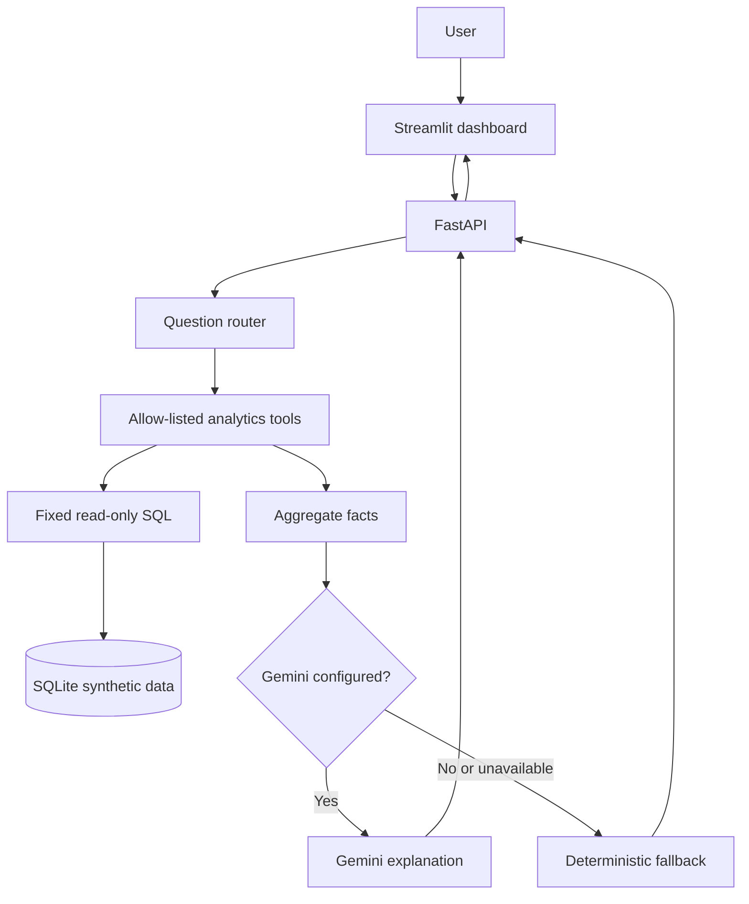

# PHS Investments — Business Intelligence & AI Analytics Copilot

<p align="center">
  <strong>A portfolio-grade analytics demo combining SQL, Python, APIs, interactive dashboards, and a guarded natural-language analytics assistant.</strong>
  <br />
  <em>Built with synthetic data only — not a real PHS Investments reporting system.</em>
</p>

<p align="center">
  
  
  
  
  
  
  
</p>

## Live demo

- **[Open the live Streamlit dashboard](https://phs-bi-dashboard.onrender.com)**
- **[FastAPI health check](https://phs-bi-api.onrender.com/health)** — expected response: `{"status":"ok","data":"synthetic"}`
- **[Interactive API documentation](https://phs-bi-api.onrender.com/docs)**

The hosted demo uses synthetic data only. Free hosting may take a short time to wake up after inactivity. The optional Gemini integration may be unavailable unless a valid API key is configured in the hosting environment.

## Overview

Mutual-fund distribution teams need a reliable way to understand transaction flows, city and scheme performance, SIP registrations, and transaction quality. This project demonstrates one way to turn relational data into decision-support analytics: fixed SQL queries calculate the metrics, a FastAPI service exposes them, a Streamlit dashboard visualizes them, and a constrained assistant answers natural-language questions using approved analytics tools.

The focus is not just generating an answer. It is **showing where the answer comes from, keeping calculations deterministic, and making unsupported conclusions explicit**.

> **Important:** All names, records, and figures in this repository are synthetic and for learning purposes. They do not represent actual PHS Investments performance, real clients, AUM, accounting revenue, investment returns, or investment advice.

## At a glance

| Capability | What the demo provides |
|---|---|
| Data layer | Relational SQLite database populated with reproducible synthetic records |
| Analytics | Read-only SQL-backed overview, monthly flows, city/scheme rankings, SIP summaries, and failure analysis |
| API | FastAPI endpoints with request validation and interactive OpenAPI docs |
| Dashboard | Streamlit KPI cards, Plotly charts, tables, and an analytics chat interface |
| Assistant | Question routing to an allow-list of analytics tools; optional Gemini explanations |
| Fallback | Deterministic answers when Gemini is not configured or is unavailable |
| Validation | pytest regression suite plus a documented 20-scenario evaluation plan |
| BI workflow | CSV exports and a Looker Studio reporting guide |

## Dashboard preview

Screenshots included in the repository:

| Dashboard overview | City performance | Transaction quality |
|---|---|---|
|  |  |  |

For the reporting walkthrough and definitions, see the [Looker Studio dashboard guide](docs/LOOKER_STUDIO_DASHBOARD_BUILD.md). For interpretation of the synthetic dataset, see [Business Insights & Recommendations](docs/BUSINESS_INSIGHTS.md).

## Example questions

Ask the assistant questions such as:

- “What are the total inflows and outflows?”
- “Show monthly net investment flows.”
- “Which city has the lowest inflows?”
- “Which scheme has the highest net flows?”
- “What is the transaction failure rate?”
- “Compare Bengaluru and Noida.”
- “Why did failures increase in December?”
- “What is the current AUM?”
- “How can we reduce transaction failures?”

The expected behavior includes refusing to infer AUM or commission revenue from transaction flows, not inventing failure root causes, protecting individual-client information, and refusing database modifications.

## Synthetic-data example findings

The current seeded demo dataset illustrates how the application surfaces evidence:

- **12,000 transactions** are represented in the transaction-quality summary.
- **351 failed transactions**, an overall failure rate of **2.93%**.
- **PURCHASE** has the highest observed failure rate by transaction type in this sample at **3.11%**.
- The monthly failure rate reaches **4.44% in December 2024** in the sample.

These figures are illustrative outputs from synthetic data, not real business results. They identify patterns worth investigating; they do **not** explain the causes of failures. See [Business Insights & Recommendations](docs/BUSINESS_INSIGHTS.md) for definitions, caveats, and suggested follow-up analysis.

## Architecture



### Design and safety choices

1. **Calculations stay in code and SQL.** The model is not the source of truth for KPI arithmetic.
2. **No arbitrary model-generated SQL.** User questions are routed to an explicit allow-list of analytics functions.
3. **Aggregate facts only.** The assistant is designed to work with summarized results rather than raw individual-client records.
4. **Deterministic fallback.** Core analytics remain usable without a Gemini key.
5. **Explicit limitations.** Transaction flows are not treated as AUM or recognized revenue, and correlations or spikes are not presented as proven causes.

This is a local portfolio prototype, not a production financial system. It currently has no authentication or production-grade authorization, monitoring, or operational controls. Do not expose it publicly with real or sensitive data.

## Technology stack

| Layer | Technologies |
|---|---|
| Data and metrics | Python, SQL, SQLite |
| API | FastAPI, Pydantic, Uvicorn |
| Dashboard | Streamlit, Pandas, Plotly |
| Optional language model | Google Gen AI SDK / Gemini |
| Testing | pytest |
| Business intelligence | Looker Studio; CSV exports for additional BI workflows |

## Run locally

**Prerequisites:** Python 3.11 or 3.12 recommended, Git, and a terminal.

### 1. Clone the repository and install dependencies

```bash
git clone https://github.com/HARSHDEEP-SINHA/phs-investments-business-analytics.git
cd phs-investments-business-analytics

python -m venv .venv
source .venv/bin/activate
python -m pip install --upgrade pip
pip install -r requirements.txt
```

On Windows PowerShell, activate the environment with:

```powershell
.venv\Scripts\Activate.ps1
```

If the repository contains `.env.example`, copy it to `.env`. Start with the Gemini key blank; the deterministic path does not require a key.

### 2. Start the API

From the repository root:

```bash
uvicorn backend.main:app --reload
```

The application initializes the local SQLite schema and seeds synthetic data on startup.

- Health check: [http://127.0.0.1:8000/health](http://127.0.0.1:8000/health)
- Interactive API docs: [http://127.0.0.1:8000/docs](http://127.0.0.1:8000/docs)

### 3. Start the dashboard

Open a second terminal, activate the same virtual environment, and run:

```bash
streamlit run frontend/streamlit_app.py
```

Open the local URL printed by Streamlit, usually [http://localhost:8501](http://localhost:8501).

### 4. Run the automated tests

From the repository root with the virtual environment active:

```bash
python -m pytest -q
```

The latest locally reported run during project development completed with **23 passed**. Re-run the command on the version you clone to confirm its current status. Passing unit tests does not automatically mean every end-to-end evaluation case or the optional Gemini path has passed.

### 5. Enable Gemini (optional)

Add a Gemini API key you are authorized to use to your local `.env` file:

```dotenv
GEMINI_API_KEY=your_key_here
GEMINI_MODEL=gemini-2.5-flash
```

Restart FastAPI after changing environment variables. Model availability, quotas, and billing depend on your account and service configuration. If Gemini is not configured or a request fails, the application falls back to a deterministic response.

**Never commit `.env`, API keys, service-account credentials, or real client data.**

## API reference

FastAPI exposes interactive request and response schemas at `/docs`.

| Method | Endpoint | Purpose |
|---|---|---|
| `GET` | `/health` | Health check and synthetic-data marker |
| `GET` | `/api/overview` | Aggregate KPI totals |
| `GET` | `/api/monthly` | Monthly inflows, outflows, and net flows |
| `GET` | `/api/cities` | City-level synthetic performance |
| `GET` | `/api/schemes` | Scheme-level synthetic performance |
| `GET` | `/api/sips` | SIP status and registered monthly values |
| `GET` | `/api/failures` | Aggregate transaction failure counts and rates |
| `POST` | `/api/chat` | Route a natural-language question to approved analytics |

### Example: ask the analytics agent

```bash
curl -sS -X POST http://127.0.0.1:8000/api/chat \
  -H "Content-Type: application/json" \
  -d '{"question":"Which transaction type has the highest failure rate?"}'
```

The chat response includes the answer, selected tool, aggregate facts, and a flag indicating whether Gemini enhanced the response. This makes it possible to inspect not only the wording but also the tool and evidence returned.

## Metric definitions

| Metric | Definition | Important distinction |
|---|---|---|
| Inflows | Successful `PURCHASE`, `SIP_INSTALLMENT`, and `SWITCH_IN` amounts | Transaction flow, not revenue or AUM |
| Outflows | Successful `REDEMPTION` and `SWITCH_OUT` amounts | Transaction flow, not a valuation measure |
| Net flows | Defined inflows minus defined outflows | Not investment performance or client balance |
| Active clients | Client records whose status is `Active` | Different from transacting clients |
| Transacting clients | Distinct clients with successful transactions | Activity count, not assets held |
| Active SIP monthly value | Sum of registered monthly amounts for active SIP records | Not proof of actual monthly collections |
| Failure rate | Failed transactions / all transactions in the group × 100 | Always interpret alongside the denominator |
| AUM | Not calculated by this project | Requires holdings and valuation data |
| Commission revenue | Not calculated by this project | Requires fee accruals and accounting/revenue data |

All values and records are synthetic. Do not describe transaction flows as AUM, returns, realized commission revenue, or client account balances.

## AI evaluation and validation

The [AI Analytics Copilot Evaluation Plan](docs/AI_EVALUATION_PLAN.md) defines 20 scenarios covering routing, rankings, transaction quality, ambiguity, privacy, unsupported financial metrics, and evidence-based recommendations.

The evaluation approach distinguishes between:
- **Automated regression tests** for deterministic code and core behavior.
- **API scenario runs** that collect the selected tool, answer, and facts.
- **Source verification** comparing returned facts with the underlying API/SQL results.
- **Gemini-path evaluation** when the optional model integration is configured.

A scenario should be marked **Pass** only after its tool, facts, ranking/direction, and caveats have been checked. Successful HTTP responses alone are not proof of correctness. The deterministic path does not validate Gemini-backed behavior; evaluate the two paths separately.

## BI exports

Generate local CSV files and a data-quality report with:

```bash
python -m scripts.export_powerbi_data
```

Generated `exports/` files are local-only and ignored by Git. See:
- [Looker Studio dashboard guide](docs/LOOKER_STUDIO_DASHBOARD_BUILD.md)
- [Power BI report guide](docs/POWER_BI_GUIDE.md)

Power BI Desktop is a Windows application; the exported CSVs can also be used in other BI tools.

## Repository structure

```text
backend/
  database.py       # Schema and deterministic synthetic-data generation
  analytics.py      # Fixed, read-only SQL analytics
  agent.py          # Question routing and answer generation
  main.py           # FastAPI endpoints
frontend/
  streamlit_app.py  # Dashboard and chat interface
sql/
  portfolio_queries.sql
scripts/
  export_powerbi_data.py
tests/
  test_analytics.py
docs/
  AI_EVALUATION_PLAN.md
  ARCHITECTURE.md
  BUSINESS_INSIGHTS.md
  LEARNING_GUIDE.md
  LOOKER_STUDIO_DASHBOARD_BUILD.md
  POWER_BI_GUIDE.md
  PROJECT_PLAN.md
  screenshots/
```

## Roadmap

- [x] Synthetic relational data and read-only SQL metrics
- [x] FastAPI backend and Streamlit dashboard
- [x] Optional Gemini explanations with deterministic fallback
- [x] Aggregate transaction-failure analytics and core safety responses
- [x] BI export workflow and Looker Studio guide
- [x] Automated regression tests and documented evaluation scenarios
- [ ] Complete and record source-verified results for all 20 evaluation scenarios
- [ ] Compare deterministic and Gemini-enabled behavior in separate runs
- [ ] Add validated date-range filters and further data-quality checks
- [ ] Optional BigQuery integration and cloud deployment
- [ ] Add authentication and production security controls before any public deployment

## Interview-ready summary

> I built a synthetic-data business intelligence application using Python, SQLite, SQL, FastAPI, and Streamlit, with an optional Gemini-backed natural-language analytics assistant. The project exposes reusable KPI endpoints, visualizes monthly and segment-level trends, and routes questions to approved read-only analytics tools. I also documented metric definitions and safety boundaries—for example, transaction flows are not AUM or recognized revenue, and a failure-rate spike does not establish root cause. The dataset is synthetic, so the project demonstrates my technical workflow rather than actual business performance.

## Documentation

- [Business Insights & Recommendations](docs/BUSINESS_INSIGHTS.md)
- [Architecture](docs/ARCHITECTURE.md)
- [AI Analytics Copilot Evaluation Plan](docs/AI_EVALUATION_PLAN.md)
- [Looker Studio dashboard guide](docs/LOOKER_STUDIO_DASHBOARD_BUILD.md)
- [Power BI report guide](docs/POWER_BI_GUIDE.md)
- [Learning guide](docs/LEARNING_GUIDE.md)
- [Project plan](docs/PROJECT_PLAN.md)

## Disclaimer

This repository is a learning and portfolio project. All records are synthetic. Do not represent its names or figures as actual PHS Investments results, customer data, investment advice, or financial reporting.
