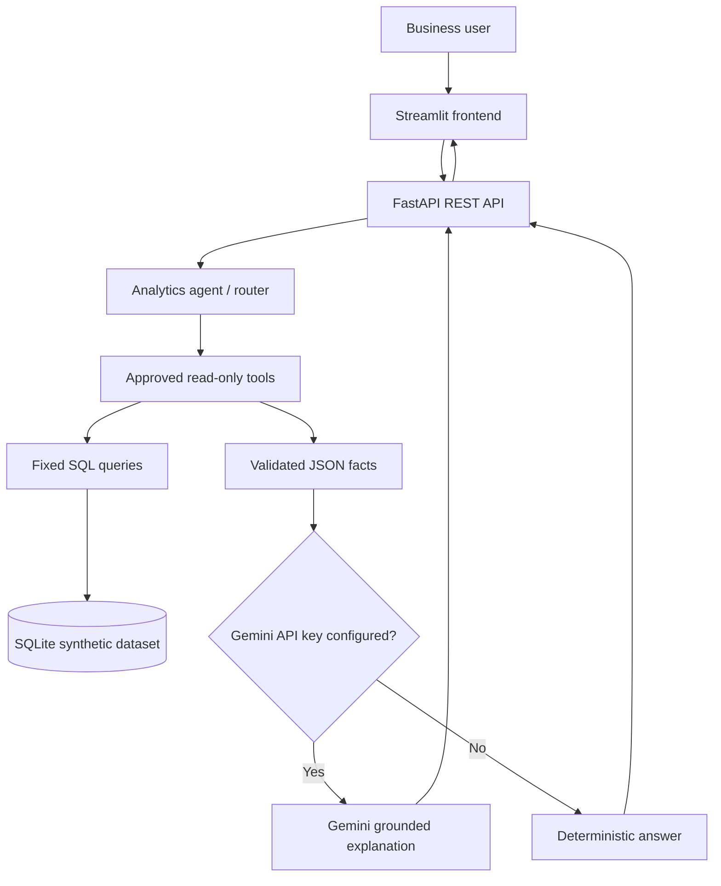

# Architecture

## Trust boundaries
- Streamlit is a presentation layer; it does not access the database directly.
- FastAPI validates request length and exposes explicit endpoints.
- Analytics functions use fixed SQL; user text is not inserted into SQL statements.
- The agent can call only an allow-listed set of analytics functions.
- Gemini receives only the selected question and aggregate facts, not raw client-level records.
- Gemini output is treated as generated text, not an authoritative calculation.
- The project has no authentication and is for local portfolio demonstration only. Do not expose it publicly with real data without adding authentication, authorization, rate limiting, secrets management and production security review.
